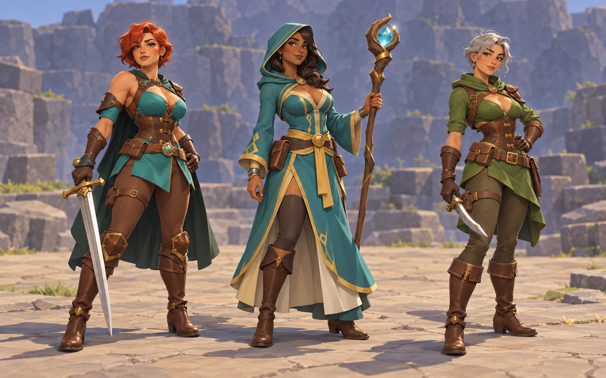
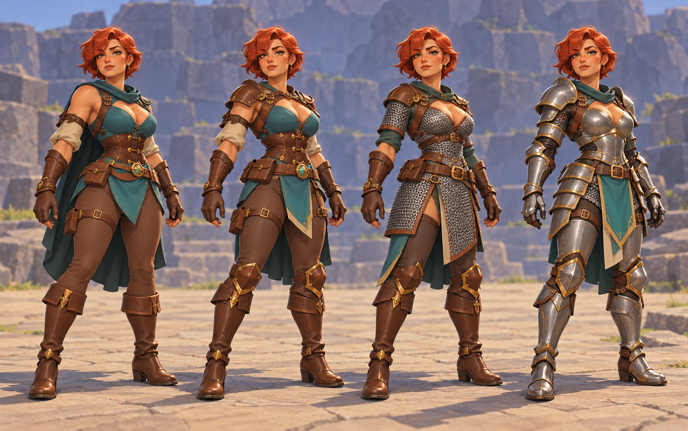
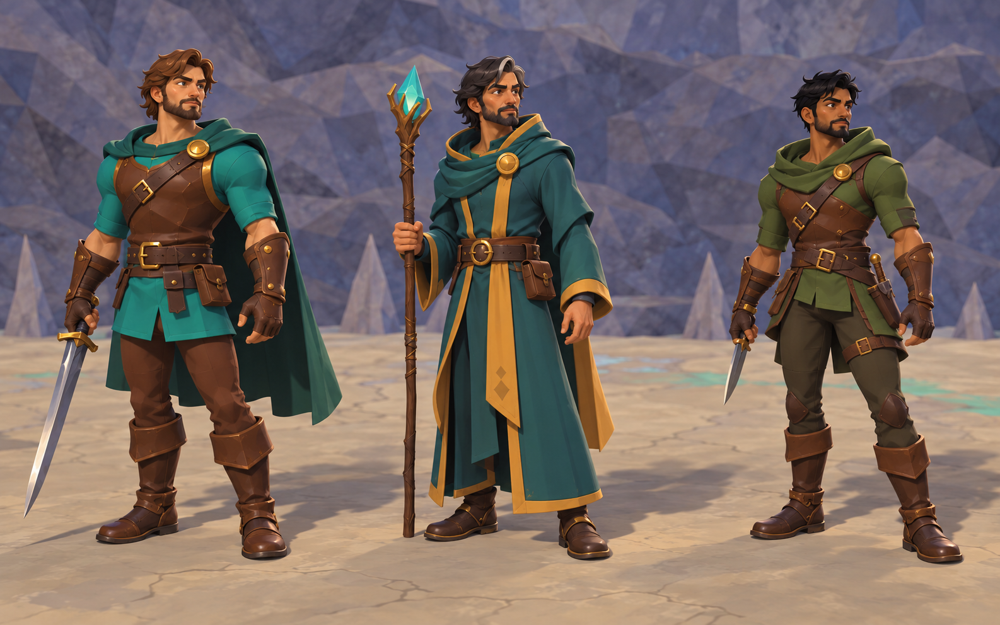
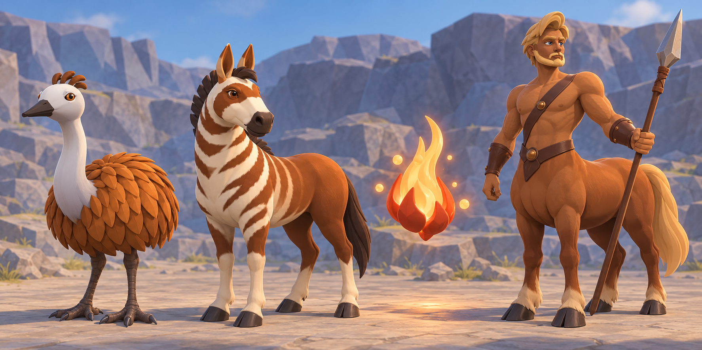

# Target generation prompts

Generated with the built-in image generation tool. These are art references,
not runtime models or screenshots of completed implementation.

## Bright foreground lighting v1

Input: storybook-gameplay-working-v9.png

Use case: lighting-study. Asset: bright, readable gameplay LIGHTING target for this existing 3D fantasy roguelike. Use the supplied ACTUAL GAME SCREENSHOT as the exact composition and geometry reference. Preserve the camera, zoom, floor and cave shapes, creatures, positions, adult Bold Storybook body proportions, existing outfits and equipped weapons, UI, labels and minimap. Change illumination and material presentation only: the whole cast and usable objects need visibly brighter, colorful, beautifully readable lighting with plenty of soft fill. Faces, teal cloth, leather, ochre feathers and green undead skin must show their actual hue and sculpted forms even on shadow-facing planes. Keep convincing directional form shading, ground contact and controlled metal glints, avoid flat unlit cutouts or washed-out skin. Warm-neutral key, generous cool-neutral fill and subtle reflected color; a few existing cyan/violet crystal notes provide sparkle. Atmosphere comes mainly from quieter cool-violet enclosing cave walls, large background shapes and existing set design. Backgrounds may be lower contrast while the playable foreground stays bright and lively. More color and pop, no muddy brown/gray veil and no crushed dark costumes. Preserve the existing strongest light directions and disclosed illuminated areas; don't create light or detail in unknown space. No added objects, particles, creatures, props, textures, details, halos, invented equipment, glowing eyes or changed UI. Don't repaint the models into another style. This is an aspirational lighting paintover for a realtime game, not an implemented screenshot.

## Bold Storybook gameplay v2

Inputs: storybook-gameplay-working-v6.png, proportion-study-v1.png

Use case: stylized-concept. Asset: full-scene target paintover for the 3D roguelike's selected BOLD STORYBOOK direction. Input image 1 is the latest actual game screenshot; image 2 is the proportion comparison, whose RIGHTMOST 'BOLD STORYBOOK' panel is the approved style reference. Produce one single game scene using image 1's exact camera, layout, creature positions, UI and dungeon geometry. Keep its current stronger character-to-world scale; do not enlarge every character again. Improve the whole cast together into coherent high-quality stylized game sculptures: broad deliberate planes, connected shoulders and hips, expressive adult heads, strong hands and feet, purposeful garments, convincing animal body masses. The teal-cloaked player has a tailored fitted leather-and-cloth fantasy outfit and a readable existing weapon; gaunt zombies have angular long hands and skulls, slim damaged silhouettes and distinct worn garments; hobgoblin is compact and heavy with a strong brow and broad hands; emu has flowing narrow feather clumps, expressive small head and credible articulated legs. Preserve each disclosed outfit and color identity while giving cloth, leather, skin, feathers and metal distinct material responses. More vivid teal, warm ochre/russet and selective cyan/violet crystal accents; cool blue-violet shadow faces, warm key light and well-grounded contact shadows. Preserve the existing light directions and major lit/shadow regions so the target is useful for a realtime implementation. Keep HUD and labels in their original places, no new objects, no added monsters, no glowing eyes or effects that weren't present. Avoid photoreal textures, excessive fine ornament, toy-plastic shine, disconnected primitive joints and a uniform saturation filter. This is an aspirational art target, not a claim of implemented rendering.

## Warrior v1

Input: warrior-baseline.png

Use case: stylized-concept. Asset: target render for an existing procedural 3D roguelike character. Redesign the warrior in the supplied actual game screenshot to a production-quality hand-carved dark-fairytale miniature. Preserve same character identity, green teal tunic and cape, brown leather laced cuirass, brown swept hair, sword, boots; same full-body three-quarter view, same cave backdrop and framing. Improve sculptural anatomy: integrated shoulders with layered cloth sleeves concealing joints, convincing elbows and wrists, expressive mature face with coherent eye sockets and jaw, deliberate broad planes and restrained bevels, believable hands gripping sword. Strong weight-bearing contrapposto with relaxed bent knees, feet firmly planted, sword held safely to side. Tailored cloth thickness, controlled broad folds, leather edge seams, forged metal bevel catching light. Handcrafted stylization, readable silhouette at small size; restrained fine detail, no photoreal pores, no toy plastic, no spherical shoulder caps or noodle limbs. Soft warm key and cool fill, grounded contact shadow. Attainable real-time game geometry and materials, no painterly brushwork, no added props, no text. This is an aspirational concept, preserve the game composition.

## Gameplay v1

Inputs: gameplay-baseline.png, warrior-target-v1.png

Use case stylized-concept. Produce a believable real-time gameplay target render by upgrading ONLY the character models in image 1, using image 2 as the warrior art direction. Preserve image 1 camera angle, zoom, cave geometry, floor, crystal positions, creature count and positions, all UI and labels exactly as presented. Warrior: integrated sleeve shoulders, coherent sculpted anatomy, tailored teal cloth and brown leather, readable sword. Zombies: distinct gaunt forward-hunched silhouettes, narrow ribcage, angular elbows, asymmetrical tattered garments, subdued sickly skin, convincing supported stances, no gore. Hobgoblin: heavier upper body and bent legs, readable broad skull and leather. Emu: anatomically credible large bird with compact feather mass, long neck and thin articulated legs. Ground every foot with contact shadows. Hand-carved dark fairytale miniature aesthetic, broad readable planes, matte cloth and leather contrasted with sharp metal highlights; restrained detail at this actual gameplay scale. No new objects, no new effects, no invented equipment, no camera changes, no photorealism. Aim for a consistent cast, visual clarity and physical presence in the existing game.

## Emu v1

Input: emu-baseline.png

Use case: stylized-concept. Asset: target render for an existing procedural game creature. Upgrade the emu in the supplied actual game screenshot into a high-quality hand-carved dark-fairytale miniature, consistent with restrained sculptural game art. Preserve the same creature, brown feather palette, pale blue-gray bare neck and legs, cave setting, full-body three-quarter composition and camera distance. Build a coherent oval torso and layered narrow shaggy feathers following the body's flow; replace broad leaf-like plates with intentional tapered feather clumps, keep detail readable. Give the neck a graceful continuous S-curve, a small wedge-shaped alert head, dark inset eyes and a short credible beak. Long legs with a clear backward hock and long lower segment, three grounded forward toes and restrained claws, balanced under the body's center of mass. Slight asymmetry in stance, one leg bearing weight, feet and shadow touching the cave floor. Broad sculpted planes, subtle feather value variation, clean silhouette, no photoreal texture, no plastic sheen, no cartoon eyeballs, no extra limbs or props, no text. Keep the existing environment essentially unchanged. This is an aspirational character art reference, not a screenshot of an implemented model.

## Richer gameplay color study v1

Input: gameplay-baseline.png

Use case: stylized-concept. Asset: exploratory COLOR DIRECTION target for the existing 3D roguelike. Use the supplied gameplay screenshot as the composition reference. Explore a richer, more vivid hand-carved dark-fairytale diorama: color can be joyful, strange and memorable while silhouettes and tactical clarity remain readable. Preserve the cave geometry, creature count and positions, camera angle, zoom and existing UI arrangement. Warrior: rich jewel teal cape and tunic, warm cognac leather, warm skin and hair, small golden brass hardware accents, clean metal sword highlight. Emu: warm sienna feather masses, blue-gray neck with subtle cobalt depth. Zombies: distinguish gaunt cool olive skin and faded plum or russet garments without neon skin or glow. Hobgoblin: earthy warm ochre and deep red-brown. Cave: mostly quiet stone midtones, but with expressive blue-violet cool shadow planes and localized warm amber light; the existing cyan and amethyst crystals provide strong small color notes. Use a clear saturation hierarchy: moderately saturated large character color blocks, strongest saturation in a few existing crystal and garment accents, quieter broad floor areas. Aim for visibly MORE COLOR AND POP than the reference without applying a uniform saturation filter. Maintain separate light/dark masses; don't crush shadows, wash the image in brown fog, turn every surface emissive, add particles, add objects or change the UI colors. Coherent sculpted models, integrated joints, grounded feet and material contrast. Real-time game render appearance, no painterly strokes, no photorealism. This is an aspirational color study, not implemented gameplay.

## Female Warrior v1

Input: female-warrior-baseline.png

Use case: stylized-concept. Asset: female Warrior target for a procedural fantasy roguelike, based on the actual screenshot. Redesign this clearly ADULT woman adventurer as an appealing heroic high-fantasy miniature. Lean modestly into fantasy tropes for figure, clothing and armor: an athletic hourglass silhouette, confidently defined waist, fuller hips and bust, long strong legs, a fitted shaped brown leather cuirass with elegant panel seams and brass fastenings, a short tailored split teal tunic over close-fitting trousers, and fitted tall brown boots. Keep the existing sword and teal cape. Armor and clothing follow a coherent adult figure and have real thickness, overlap and deliberate construction. Mature expressive face, sharp readable cheek and jaw planes, almond eyes, sculpted red-brown hair. Integrated tapered sleeve shoulders, convincing elbow and hand anatomy, poised balanced stance with one knee relaxed. Rich jewel teal, cognac leather, warm hair, small golden hardware accents; soft warm key light and cool violet fill. Hand-carved dark-fairytale game style with broad sculptural planes and material contrast, attainable real-time geometry, no photoreal pores. Preserve full body three-quarter cave composition and existing scene layout. Keep her recognizably the same adult female character, no added weapons or props, no text. This is an aspirational art reference.

## Proportion study v1

Input: gameplay-baseline.png

Use case: stylized-concept. Asset: three-panel art-direction comparison for a 3D roguelike's GAMEPLAY PROPORTIONS, based on the supplied actual gameplay screenshot. Make one landscape comparison sheet with three equal panels showing the same cave encounter, same high gameplay camera angle, same creature count and approximate arrangement (teal-cloaked adult warrior, gaunt zombies, emu, hobgoblin, crystal-lit cave). Use the polished hand-carved dark-fairytale style and rich teal/amber/blue-violet palette consistently in all panels. Panel 1 label exactly 'REFERENCE PROPORTIONS': preserve approximate character-to-floor scale from the input. Panel 2 label exactly 'HEROIC READABILITY': characters have roughly 20 percent stronger screen silhouettes relative to the floor, adult heroic proportions, broader expressive hands and distinctive heads, clear weapon mass, bolder cloth/armor shapes, distinct animal masses; retain plausible adult anatomy and movement clearance. Panel 3 label exactly 'BOLD STORYBOOK': more deliberate sculptural exaggeration, larger heads/hands/feet and recognizable creature features, stronger mass contrast and shorter compact torsos, roughly 30 percent stronger silhouettes relative to the floor, still clearly adult fantasy figures and credible balanced stances. Female silhouettes may have a defined waist and fuller figure with fitted fantasy clothing and armor. Preserve differences among human, gaunt undead, stocky hobgoblin and long-legged bird. Show all three at the SAME image scale/camera distance so the differences come from model proportions and character/world scale, not zoom. Keep the shared environment broadly consistent but simplify background texture for legibility. Labels belong above each panel; omit the original HUD and minimap from all panels. Avoid photorealism, childlike characters, chibi heads, new monsters, decorative closeup inserts or extra text. This is a concept comparison, not a runtime screenshot or mechanical scale change.


## Procedural cast and equipment references — 2026-10-17

Generated with the built-in image generation tool, using the current v19 client captures as visual references; the equipment sheet additionally uses the new female-adventurer sheet. These are aspirational art references, not client screenshots or evidence that modular armor rendering is implemented. Female prompts explicitly request adult women. All outputs were visually inspected.

Use these for clothing fit, layered materials, mature faces, color, coherent creature anatomy, and reusable design vocabulary. The humanoid figures are taller than the compact Bold Storybook target: preserve the established in-game proportions rather than copying their leg length. The plate study also exaggerates breast contouring; a continuous convex chest shell remains the intended heavy-armor construction. Static sheets do not validate animation, equipment deformation, or collision clearance.

### female-adventurers-target-v2.png



Prompt transcription for publication:

```text
Use case: stylized-concept.
Asset type: aspirational 3D character mock-up reference sheet for a procedural fantasy roguelike.
Primary request: a fresh, polished Bold Storybook design study of three adult women adventurers, unmistakably mature women ages 25–40: a warrior, a mage, and a ruin scout.
Input images: Image 1 is the current Warrior model lineup, Image 2 the current Mage lineup, Image 3 the current ruin scout lineup. All three are reference images for role, compact body proportions, expressive palettes and outfit vocabulary, not edit targets. Improve the craft and appeal rather than copying screenshot artifacts.
Subject: three distinct confident adult female figures with curvy but credible anatomy, shaped busts, narrow waists, strong hips and thighs, expressive mature faces, useful hands and boots. Warrior: fitted teal fantasy bodice, cognac leather straps, gold buckle, sculpted bracers, practical sword. Mage: fitted teal and gold upper garment, flattering neckline, connected layered robe with leg movement clearance, carved staff. Scout: moss green fitted tunic with flattering neckline, chestnut leather belt and bracers, shaped trousers and boots, short blade.
Style/medium: high quality stylized real-time 3D mock-up, sculpted low-poly planes with smooth major volumes, restrained painted detail, compact heroic Bold Storybook silhouettes around six heads tall. fantasy costume design, composed and capable adult characters. Readable at gameplay scale.
Composition: wide landscape sheet, three separated full-body three-quarter figures at equal scale, including feet, enough space around weapons. Subtle differences in grounded stance and personality; no action blur.
Lighting/background: bright warm foreground key, soft neutral fill, visible faces and clothing shadows, gentle contact shadows on a simple open stone stage, muted slate-blue distant background, no ceiling.
Materials: distinct matte cloth, warm leather, small metallic accents; garments follow anatomy with credible layered seams and clean overlap. Favor forms reusable through procedural body and garment parameters.
Constraints: preserve mature adulthood and Bold Storybook proportions; no chibi, no childlike faces, no photoreal humans, no exaggerated balloon anatomy, no cloth/body clipping. No nudity, no text, no logos, no watermark, no UI. This is future art direction concept imagery, not a claim about an implemented feature.
```

### female-armor-layering-target-v1.png



Prompt transcription for publication:

```text
Use case: stylized-concept.
Asset type: modular equipped-armor mock-up reference for a generic procedural 3D fantasy character system.
Primary request: show the SAME adult woman warrior, age 30, four times at exactly the same scale and body dimensions, in four interchangeable equipment loadouts: fitted cloth travel outfit, light leather armor, chain mail with leather harness, and articulated steel plate armor. These are equipment variants on one reusable body, not four different characters.
Input image 1: reference image for the red-haired adult warrior at left, her teal/cognac/gold palette, mature face, and attractive fantasy outfit direction. It is a reference only, not an edit target. Compact her overall proportions to Bold Storybook six-head height, with slightly larger hands and boots; keep a clearly mature face and adult curvy figure. Use the same proportions across all four loadouts.
Subject: four full-body versions of the same confident adult female warrior with an attractive hourglass figure, strong thighs, defined waist, believable shoulders and hands. All wear opaque fantasy outfits; the cloth and leather variants have flattering necklines. Mail is real interlinked metal over padded cloth. Heavy plate has a coherent convex breastplate over the torso, shaped waist, segmented hip tassets, pauldrons, elbow and knee articulation; no individual metal breast cups. Equipment follows the underlying anatomy without changing her body shape.
Design purpose: demonstrate modular shoulder, torso, forearm, waist, leg, and boot pieces that fit together through shared attachment landmarks. Each loadout has clean layering, believable thickness, clear joint gaps, motion clearance, common belt/hand positions, and a consistent shared silhouette beneath increasing armor bulk.
Style: polished sculpted real-time 3D game mock-up, Bold Storybook chunky readable forms, limited crisp facets, restrained surface detail. Attractive adult fantasy styling with practical construction.
Composition: wide landscape contact sheet, four equally spaced full-body three-quarter standing figures in the same relaxed pose, empty hands slightly clear of hips, all boots visible. No text or diagram callouts.
Lighting/backdrop: bright warm foreground light, soft cool fill, readable faces and material shading, subtle floor contact shadows, quiet open stone studio courtyard with muted blue-gray distance, no ceiling.
Constraints: same identity, same body proportions and height in every version; distinct cloth/leather/mail/steel materials. No chibi or childlike faces, no nudity, no clipping, no overlong fashion proportions, no oversized armor masses, no UI, no watermark. Aspirational visual reference, not an implemented equipment-system screenshot.
```

### male-adventurers-target-v1.png



Prompt transcription for publication:

```text
Use case: stylized-concept.
Asset type: aspirational adult male character mock-up reference sheet for a generic procedural 3D fantasy roguelike.
Primary request: three male adventurers in Bold Storybook style: warrior, mage, ruin scout. Give each a clear mature adult identity, expressive face, and distinct build while maintaining the same reusable humanoid anatomy and garment system.
Input images: Image 1 current Warrior lineup, Image 2 current Mage lineup, Image 3 current ruin scout lineup. These are reference images, not edit targets. Use the male figures in these lineups as proportions and role references; preserve their corrected broad, shallow male chest anatomy. Improve sculpture, fitted garments, hands, faces, materials and readable silhouette.
Subject: warrior, a sturdy muscular adult man with broad shoulders and a continuous shallow pectoral chest, teal fitted tunic, cognac leather straps and bracers, gold accents, sword; mage, a lean mature adult man in a deep teal robe with warm ochre/gold trim, expressive angular face, staff, connected cloth drape with believable walking clearance; scout, an agile mature adult man in moss green and chestnut leather with fitted trousers, shaped boots and dagger.
Anatomy: broad continuous male rib cages and shallow pectoral planes; no breast-like rounded paired mounds or female bust tailoring. Correct shoulders, elbows, wrists and sturdy hands; purposeful individual silhouette variation. Approximately SIX HEADS TALL, compact heroic adult proportions, substantial heads/hands/boots, not lanky fashion figures and not chibi.
Style/medium: polished stylized real-time 3D game mock-up, bold sculpted volumes, broad low-poly facets, restrained painterly detail, expressive color, game-readable forms. Outfit construction should look reusable across new procedural character recipes.
Composition: wide landscape sheet with three separate equal-scale full-body three-quarter figures, all feet and weapons in frame. Grounded relaxed poses with subtle personality, useful range-of-motion space at joints.
Lighting/background: bright warm foreground key, soft cool fill showing every face and torso, quiet open stone stage, muted slate-blue rocky distance, no ceiling, soft contact shadows.
Materials: matte woven cloth, warm leather, restrained metal glints, natural hair masses; clean fitted layering and seams.
Avoid: photorealism, grotesque anatomy, childlike faces, oversized breast-like chest forms, body/garment clipping, black shadowed faces, overbusy microdetail, text, UI, logos, watermark. Concept imagery only, not an implemented feature claim.
```

### creature-families-target-v1.png



Prompt transcription for publication:

```text
Use case: stylized-concept.
Asset type: aspirational creature-family mock-up reference sheet for a generic procedural 3D fantasy roguelike.
Primary request: four distinctive creatures rendered in one coherent Bold Storybook art direction: an emu, a quagga, an ember wisp, and a mature adult male centaur.
Input images: 1 current emu, 2 current quagga, 3 current ember wisp, 4 current adult male centaur. All are design references only, not edit targets. Preserve the species traits, expressive colors and approachable sculpted character while improving shape craft, material separation, anatomical connections and silhouette readability.
Subject details: Emu has a compact ovoid warm ochre-brown body, layered tapered feather clusters that hug the volume, long pale gray softly curved neck, small alert head, dark beak, sturdy bird legs and grounded splayed toes; no umbrella-shaped feather skirt. Quagga has a coherent compact equine build, chestnut coat, pale stripes on head/neck/front torso fading to solid brown hindquarters, cream lower legs, expressive dark eyes and short dark mane; correct four-leg anatomy. Ember wisp is a small floating asymmetric flame with sculpted burnt-orange outer lobes, luminous warm yellow inner flame and amber heart, a few orbiting golden sparks; readable shaded outer shape instead of a flat white glowing blob. Centaur has a muscular mature adult male human upper body, broad continuous shallow male chest, brown leather diagonal harness and bracers, expressive adult face and swept blond hair, joined organically to a strong chestnut equine body with four equine legs, tail and dark hooves, holding a simple spear. No human lower legs.
Style/medium: polished stylized real-time 3D character art with bold low-poly planes, shaped organic masses, expressive color, sparse painted detail, believable material shading. These should plausibly be built from reusable body profiles, attachment landmarks, modular anatomy and shared material rules.
Composition: wide landscape sheet, four fully visible and clearly separated full-body three-quarter creatures, all feet/tails/spear visible, no overlap. The emu, quagga and centaur stand with convincing weight and neutral motion-ready poses. Wisp floats slightly above its ground shadow. Calm open stone courtyard with quiet blue-gray rocky distance, no ceiling.
Lighting: bright warm key on foreground and faces, cool soft fill, clear soft contact shadows, gentle warm local wisp light, never obscure anatomy in darkness.
Constraints: retain each species silhouette and all limbs; mature adult centaur, no chibi human face, no paired breast-like male chest bulges, no plastic sausage anatomy, no clipping, no excessive microdetail. No text, UI, logos or watermark. Concept imagery only, not an implemented feature screenshot.
```
