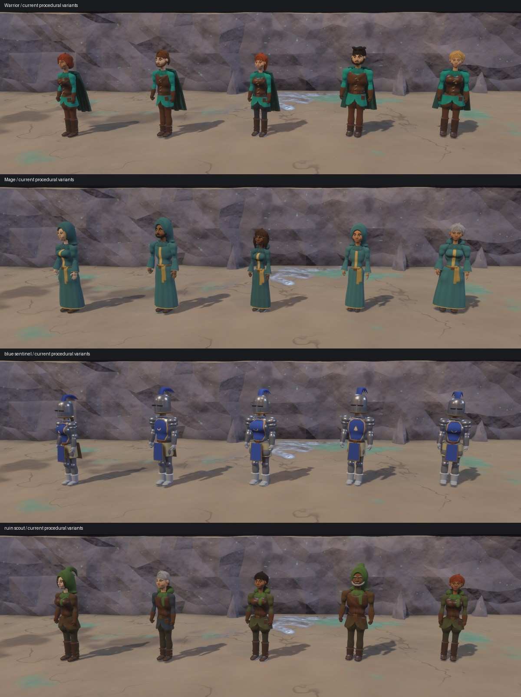

# Procedural 3D art: implementation and continuation plan

This plan records the current procedural-art foundation, its review limits and
the next useful work. The [art direction](../art/3d-art-direction.md) owns the
visual principles; the [3D client guide](../../crates/client-3d/README.md) owns
launch and diagnostic commands. This remains an independently verified frontend
prototype, not a completed art pipeline or a new gameplay milestone.

## Intended outcome

New creature recipes should compose body plans, correlated dimensions, materials,
garments, attachments and compatible motion. Improve shared construction rules
before polishing individual ornaments or isolated frames. Preserve compact Bold
Storybook proportions, expressive color, bright foreground lighting, adult
character silhouettes, a broad shallow male chest and open ceilings. Follow the
[Bold Storybook definition](../art/3d-art-direction.md#proportions-bold-storybook):
large anatomical heads, substantial hands/feet and shorter lengths establish
compactness; female figures remain lean and lightly athletic with moderate hips,
tapered thighs and clear knees. Adult women, their clothes and accessories should
be alluring while preserving balanced anatomy and species identity.
The [updated cast sheets](../art/rogue-concepts/README.md) guide species and
costume choices; their approved humanoid reference anchors the body review.

The existing implementation is mostly Rust recipes. Shared fitting data makes
future equipment composition more practical, but there is no general external
mob-authoring interface or interchangeable worn-armor renderer yet. The client
must continue to render only appearance and equipment disclosed by the server.

## What is implemented

### Sharing checkpoint — 2026-10-21

The `feat/rogue-creature-models` branch collects the current full-cast refinement
for review. Shared body dimensions, garment-owned cuts and ornaments, constructed
boots, layered armor, fitted accessories and connected lined cloaks improve
composition across native and replacement outfits. Zombie damage and Phantom
transparency survive outfit replacement. Small reusable leaf, feather, membrane,
beak, claw, shell and hoof components support further creature recipes.

The broader shape pass covers the winged beasts and birds, Aquator, Xeroc,
Flytrap, serpents and equines. Rattlesnake's extended resting pose supersedes
the coiled pose in its reference sheet. Ice Monster refinement stays deferred.
The dated reference index retains the supplied full cast and approved humanoid
anchor, with filenames, sizes and hashes checked against the originals.

This is a reviewable modeling checkpoint. Adult face/neck transitions, hair and
hood overlap, general moving-cloth collision, whole-cast motion review and
controlled crowd-cost measurements remain open. The following construction
summary and continuation order distinguish these limits from implemented work.

| Foundation | Implementation | Current boundary |
| --- | --- | --- |
| Body dimensions | `creatures/anatomy.rs` resolves biped dimensions, joint landmarks, limb/foot shapes and Storybook mesh scales once per rig | Guardian and Yeti retain distinct recipes; equines and centaurs retain their own dimensions |
| Build variation | Existing slender/average/sturdy choices link shoulders, waist, pelvis and muscle fullness | Average proportions and vertical bone lengths are anchors; this is not unrestricted morphology |
| Shared fitting | Geometry, robe clearance and animation support use the resolved body; lateral joint roots and garment widths follow it | Arbitrary equipment fitting and compatibility are not implemented |
| Torso layers | Cloth, leather and plate use material-specific rib/back ease; structured fronts bridge the chest with a fitted waist | Existing family cuts remain; sleeves and complete garment patterns need more work |
| Figures | Each woman rolls her own figure, leaning toward her kind's typical one; the chest form is sculpted on a parameterized chest wall (bipeds and the centaur rider); garments name their support | Shapes are tuned by eye; no scaled or furred woman yet exercises a flatter species chest |
| Necklines and openings | Garments own split, deep and court plunge cuts resolved against the wearer; outer shells and a woman's low-cut plate open along the same cut; armholes close under the arm; bare-legged garments are cut high | Edges are painted plus fitted bindings, so very coarse meshes can still show a stepped paint edge beside the binding |
| Soft tissue | Soft regions are skinned to spring-driven bones that answer the body's acceleration in any motion; plate holds them, structured garments damp them | One spring per side; no cloth-on-skin interaction or per-move tuning |
| Pelvis | One sculpted pelvis inside the fitted envelope; skirts measure it at the belt line and widen only where the thighs press | The envelope radii still bound fits elsewhere |
| Faces | Joined lower-face/chin forms, surface-fitted mouth contours and family-specific nose/fang/tusk clearance | Expression comes from sculpted geometry; no facial-animation system |
| Cloth | Each caster owns a continuous double-sided robe and bound sash, fitted to the final supported pose | Approximate body proxies and bounded contact correction cannot guarantee every contact is clear |
| Motion | Grounded support/swing paths, turning, interrupted actions, supported falls and family-specific locomotion | Still-image review does not establish real-speed timing or absence of foot sliding |
| Model resources | Live meshes remain referenced; idle reuse is bounded by payload and key budgets | The idle budget is not a bound on total CPU memory, live assets or VRAM |
| Shape and rendering | Connected organic joints, fitted trim, feather/floater forms, foreground lighting and material separation | Some forms still read as rounded primitives or a coating over anatomy |
| Non-humanoid composition | Explicit support/grasp limb roles, authored bend landmarks, profiled limbs and claw palms; oriented thick scutes and fang arcs | Species proportions and placement remain Rust recipes; there is no external monster format |
| Adult eyes and brows | Substantial fitted female brows and controlled arches; one almond eye boundary shared by clipped iris/pupil surfaces, fitted lids and a visible upper lash line; iris-only glow and Medusa slit pupils | Lower-lid rims, species expression and adult cheek/jaw planes still need style work |
| Review tools | Offline lineups (with `--women`, `--jump`, `--turn` and timed motion frames), fallen lineups, travel studies, appearance controls, camera azimuth and capture warmup | These are diagnostic views, not gameplay authority or automatic visual-quality scores |

The renderer retains remote-main's synchronous material-pipeline setup and CPU
DX12 frame pacing alongside adjacent shader-compiler discovery. Explicit renderer
and compiler overrides remain available. Live play and diagnostic views share
the camera shading setup.

## What is working, and what that evidence establishes

Before the current remote-main rebase, the shared body/profile pass was reviewed
across all 18 families and five individuals per family in ordinary and side views.
Sampled travel, actions and fallen poses preserved broad support and family
identity. Adult figure relationships, the male chest correction and accepted
human/humanoid mouth work survived that pass. These findings establish a useful
visual baseline; they do not automatically qualify every later source revision.

The first torso-material preview had a narrower review: Warrior, Sentinel and
Vampire variants retained their adult silhouettes and fitted waists. The clearest
gain was the Sentinel's continuous chest shell. Leather and cloth changes were
subtler and did not resolve the overall garment-construction problem.

The rebased PR snapshot was captured again in normal and side lineups. Ordinary
views were reviewed for Warrior, Mage, Sentinel, Scout, Hobgoblin and Vampire,
with Guardian, Yeti, Quagga and Centaur controls; the six torso families were also
reviewed from the side. No broad static proportion or outfit-fit regression was
identified. This extends the torso review, but does not approve real-speed motion
or every cloth contact. The following image is actual rendering, not a generated
target:

Focused PR checks exercise cache eviction without losing visible geometry,
correlated dimensions and rig landmarks, closed finite neutral robe geometry,
structured torso surfaces and a launched native renderer. Existing appearance
identity, disclosed combat reaction and native attack witnesses own their
unchanged boundaries. Full supported-platform/profile coverage belongs to the
independent 3D CI matrix; focused local checks are not a substitute for that matrix.

## Current challenges

The updated Bold Storybook definition requires a fresh proportion and costume
review. Earlier construction checks and accepted snapshots do not prove that
anatomical skull size, compact lengths, adult faces, lean female anatomy or
alluring costume design meet this target.

1. **Garment construction remains the largest modeling gap.** Torso layers now
   have a little material-dependent room, but many sleeves and costumes still
   inherit the body's rounded form. Cloth needs supported regions, elbow and
   underarm ease, free edges and coherent folds; leather needs panel structure;
   plate needs protective shells and deliberate articulation/overlap.
2. **Body, outfit and motion recipes remain partly coupled.** `Style` still
   combines species, outfit and behavior choices. The resolved body is a useful
   seam, not complete separation of these concerns.
3. **Continuous cloth has bounded, approximate contacts.** A small intermittent
   angular dark patch remains documented from earlier travel review. Its exact
   surface identity was unresolved. Keep it behind broad construction work unless
   it exposes a general failure; repeated tiny crop/fix loops are not the priority.
4. **Real-speed motion is not approved.** Review foot plants, weight transfer,
   turn/stop/restart transitions, action interruptions and revival in motion.
   Do not infer timing quality from a contact sheet.
5. **Resource and update cost need controlled measurements.** Existing runtime
   observations are not isolated cloth, mesh-upload or GPU measurements. Preserve
   live references and bounded idle reuse while measuring representative crowds.
6. **References are aspirational.** The generated humans are taller than the
   selected compact in-game direction. The armor study exaggerates chest shaping;
   use coherent protective shells rather than copying separate chest cups.

## Continue in this order

### 1. Establish the exact reviewed baseline

Reassess representative anatomy and outfits against the updated Bold Storybook
definition before treating older proportion anchors as accepted. Compare the
anatomical skull, ribcage, pelvis, hands and feet separately from costume mass;
review front, side, rear and action silhouettes at gameplay and portrait scales.
Keep adult female appeal explicit while correcting inflated hip/thigh masses
through shared body dimensions and garment fitting.

Build the rebased frontend with its matching backend. Use fixed seeds, camera,
scale and lighting for comparisons. Finish the latest torso-layer review in
ordinary and side views, with a few travel/action poses and live gameplay.
Record the source revision and distinguish visual acceptance from a successful
capture or test. Reuse existing diagnostic commands rather than adding a second
review framework.

### 2. Give garments their own reusable shape rules

Extend the current torso-material seam into supported/eased/free regions. Start
with Hero, Scout, Caster, Vampire and Sentinel recipes so one rule improves
several roles. Keep the anatomical support surface separate from the garment's
visible surface, and seat trim and straps on the final garment. Preserve fitted
adult curves and neckline identity; a continuous front does not require a flat
torso or a loose barrel. Give sleeves their own taper and articulation clearance.

Acceptance: the layer reads as cloth, leather or plate at gameplay distance;
waist/shoulder/hip relationships survive all supported builds; arm movement does
not expose broad disconnected surfaces. Review both sexes and all three builds
collectively, with unchanged families as controls.

Progress: limbs now have the first reusable cloth rule. A sculpt can be
inflated, so a sleeve or trouser leg is the anatomy beneath it grown by an
ease (filling the muscle hollows), with soft rolls gathered at the elbow and
below the knee; cuffs and bracers sit over that ease. Every clothed person
uses it, the Rogue folk included, and contract tests require the cloth to
clear the limb all round for every build. Draped skirts, tunic hems, coat
tails and the caster robe now hang free: their folds deepen toward the edge
and the hem drops where each fold swings out, while short edges such as cowls
stay neat. Cloaks, capes, tunic skirts, coat tails and rags now hang on
their own drape pivots: a cloak flares back as its wearer travels and trails
through turns, skirts sway with the stride, and cloth at rest barely stirs.
Cloaks now use one connected exterior and lining, sealed around a thick perimeter,
with clean or connected torn hems. Their gathered top fits the resolved upper back;
body build scales the shoulder and hem widths. The fitted upper drape reserves
selected rear strap layers so a baldric stays underneath it. Each wearer owns its cloth mesh,
while materials remain shared, including Phantom transparency. Two pinned rows
hold the upper attachment as the existing eased swing blends toward the hem.
Skirts and hair still follow their existing drape pivots. This is procedural drape,
not cloth simulation; general moving-body and floor collision remain unchecked.
Sentinel plate now articulates: overlapping lames form the
rerebrace under each pauldron and the cuisses over the thigh, each band tucked
inside the one above so bending cannot open a gap. Torso garments now have
all three regions: supported at the shoulders, eased over the ribs, and free
below the belt, where leather jerkins and vests hang as a short swinging
peplum over the tunic skirt. Coats and robes keep their own skirts.

### 3. Separate composition concerns without a new content format

Keep body morphology, outfit selection, material roles and motion constraints
explicit in internal recipe data. Use shared surface/attachment coordinates for
belts, shoulder layers, held items and future worn equipment. Preserve deterministic
appearance identity and include every future independent visual choice in cache
identity. Do not infer anatomy or equipment slots from display prose.

Progress: outfit selection is now internal recipe data apart from the body. An
outfit names what each slot wears: arms (bare, sleeved or plate), legs (fitted,
trousered or plate), boots (height, heel, buckles, cuff), hands, cuffs, an outer
layer (a jerkin, vest or coat, or a cuirass with tabard and gorget), the tunic
skirt and a cloak. Neckline, lower-panel split, hem trim and cutaway construction
belong to the outfit, including the outer jerkin's free peplum. Its split,
pigment and hem trim travel with the garment, independently of the wearer's
native costume. Open feminine bodices retain their shaped neckline on
sentinels, undead and other wearers; plate keeps its continuous closed shell.
Skirts are cut for the resolved pelvis and thighs, preserving fitted waists,
balanced hip contours and enough clearance for the wearer's legs. A shared cloth surface
also fits the jerkin's peplum over the actual tunic cut, including its placement,
Storybook scale, fold phase, raised trim and shell thickness. The outer waist
now attaches to the selected torso shell's actual waist section, including its
Storybook scale and front/back centre. Shell emission and seam fitting share
one resolved sculpt with the same garment cuts. The hip and hem still expand
around the lower layer. An emitted-triangle regression checks the attachment
around front, sides and back across native and Ranger wearers; the independent
lower-layer regression checks clearance around all four sides across
native and Ranger outfits, both sexes and all three builds. It also bounds
excess stand-off: a clear shell can still form an oversized shelf. The free
hip/hem dimensions are authored independently from the narrow sewn waist, so
fitting the lower layer does not inflate an already adequate hem. Clearance
is resolved on the cloth's radial vertex grid at matching physical heights and
angles. A lifted split edge expands its supporting panels without widening the
entire garment. Closed front edges remain coincident under asymmetric support;
open split edges keep their separation. This establishes resting clearance;
independently moving drapes still need contact review.

Baldrics are reusable accessories: the warrior, scout, ranger and knight use
one assembly fitted over their torso layers. Independently clipped outer
sculpts combine with the tunic beneath them; a short vest does not cut away
the shoulder support. The cuirass resolves once for rendering and attachment,
and accessory clearance includes raised heraldry. A grown support envelope is
traced before emitting the strap, avoiding normal-offset folds at tight waists.
Front and back strips share seam rows with shoulder and waist turns, forming
one closed loop with inner surfaces and real thickness. The shoulder and belt
landmarks set its span; buckle placement follows a height along the path.
Open buckle frames and tongues follow the strap direction and surface normal.

Shared shoulder armor now uses a broad faceted crown and a thinner overlapping
lower plate. Inner surfaces fit the resolved arm, including muscle fullness
and the clavicle insertion; turned edges expose the metal thickness. This
replaces the two rounded shoulder pads without changing the arm joints.

Harnesses, stocks and buttons, leaf bodices, neck bands and discs, and knotted
sashes are explicit outfit ornament recipes. Their materials and optional
shoulder straps or scarf travel with the selected ornament; the renderer no
longer looks up those costumes from the wearer's native kind. Mesh witnesses
transfer each recipe onto an unrelated wearer and remove it again. Neckline
and armhole edging, collar binding and armor gorget pigment also belong to the
outfit. Native and Courtier retain their authored trim; Commoner and Ranger use
their own cloth binding, and Knight uses its armor gilt. Ranger selects its own hip pouch
on every wearer; Native keeps the warrior's and scout's pouches.

Torso attachments trace the combined body and selected structural garment, so
an opening or short shell does not remove their underlying support. Sewn edges,
harnesses and scarf tails retain their authored pattern-plane coordinates while
their depth fits a grown support surface. Complete rows end where their full
width loses support, instead of clamping individual vertices toward the neck or
waist.
The native female vampire keeps her open bodice without the male cravat; both
retain their rows of gold buttons. Emitted-mesh witnesses cover native Medusa
bindings, Orc harness/scarf, transferred Orc layers and the sex-specific cravat.
Binding shading, neckline construction, painted edges and action-pose clearance
remain unfinished. A detailed ribbon-shading experiment is shelved while the
rougher Rogue creature families receive anatomy and silhouette refinement.
It has not earned visual acceptance and is not part of the current renderer.
Oblique visibility alone cannot prove
self-intersection: legitimate cap exposure can lie ahead of a more distant part
of the same curved strip. Static checks do not establish full costume approval.

Other native costume trimmings (lacing, cowls and loincloths) remain
recipe-specific. Body traits, including the medusa's serpents, and the zombie's
decayed, torn-shirt treatment survive wardrobe changes. Native leprechaun coats
retain their front cutaway. These construction rules preserve creature identity
while an exchanged garment carries its own design. Static mesh/topology and
clearance checks do not establish full motion/contact or visual acceptance.

An offline wardrobe (commoner, ranger, knight, courtier) dresses any humanoid
that wears separable clothes; stone, fur and robed casters do not. Each dressed
look has its own cache identity. The bestiary's `--outfit NAME` dresses its
humanoids, and O, or `--wardrobe-cycle SECONDS`, redresses them mid-stride,
replacing only the model while motion carries on. Repeated recipe-level outfit
changes retain the individual's original cache identity: selecting an outfit
again reuses its model, and Native restores the original costume. Unchanged
head and hair assets are reused across sequential replacements. This is presentation for
review only: live creatures still wear their kind's outfit, as observations
carry no equipment list (see 5).

Outfits also carry headwear: bare, a hood up or pushed back, or a closed helm.
A hood or helm covers hair and what is worn in it, and pointed ears fold inside
it; what the body grows, such as serpents, still shows. Redressing reuses the
head and hanging hair when the outfit leaves them alone.

The current people recipes place the head on a short neck and slope shoulders
into the arms. Female pelvic breadth and thigh muscle volume are now independent;
moderate hips place the leg roots, while the build profile shapes a leaner upper
leg and clear knee taper. Emitted-mesh cross-sections cover six humanoid families,
both sexes and all three builds, retaining calf recovery, fine ankles, pelvis
depth and the existing knee/ankle landmarks. Garments use the same revised body
support. These geometric contracts do not establish full style acceptance.
Organic female thighs now share four blended anatomical masses: upper
attachment, quadriceps, distal taper and knee. Width and depth change
independently along the limb. Longitudinal overlap joins the masses without
intermediate pinches, and the upper-shin cap fits the knee's narrower contour.
Build choices retain their muscle differences. The
sculpt, trouser and plate fitting, mesh bounds and posed robe contacts consume
that same description; the robe's analytical rays and contact proxies include
the accumulated blend allowance. Emitted front/side sections check contour
variation and bilateral agreement and the combined knee envelope without moving either joint. Native
front, side, rear and action views remain the artistic acceptance evidence;
these geometric checks alone do not establish the intended silhouette. The
other limb recipes and the separate stone/fur body constructions retain their
existing forms. Medial/lateral planes and the combined knee/shin silhouette
still need continued review against the approved body reference.
Continue reviewing the anatomical skull independently of hair, adult
brow/cheek/nose/jaw structure, connected torso masses and action silhouettes. Long loose hair is one sculpted
fall from the crown, and cloaks, skirts and hair ease into their swings.

Kestrel flight and tail feathers and the Griffin wing feathers share
one closed vane generator. Broad faces narrow progressively into a point, with
a slim central ridge and thickness proportional to width. Family palettes and
Kestrel barring remain recipe choices. Staggered rows of short coverts follow
both spread and folded wing planes, overlapping the longer secondaries. Their
bowed outlines and raised rows keep the short feathers readable as separate
shapes. Folded primary fans mirror their feather planes across the body. Broad
body/wing contact and motion review remain separate work; improved feather
construction does not establish those.

Griffin now has a larger anatomical cranium, cheek and brow beneath a raised
crest, a broad sculpted neck with surface-fitted feather groups, and shoulder
masses that continue into shorter bent forelegs. Wider talons retain planar
support, while the lion hindquarters keep distinct hocks and paws. Griffin and
Kestrel share closed ridged hooked mandibles; their cere and palette remain
recipe choices. Focused geometry and motion tests and native front/side/rear
lineups support this proportion pass. Feather/wing joins, full action/fall
surface clearance and overall finish remain open.

Bat and Dragon skin panels now share a closed tensioned membrane fan with
curved scalloped edges, shallow inter-finger camber, smooth surface normals and
physical perimeter thickness. Explicit outward facing preserves outer/inner
pigments on both mirrored wings. Aquator toe webs reuse the same skin at foot
scale; Bat's wing bones are more substantial. Focused closure, anchor and
mirroring tests and native front/side/rear views support this construction pass.
Complete finger/body contact through every wing pose and the wider creature
anatomy remain visual review work.

Dragon now uses shorter bent fore/hind support vectors, connected shoulder and
haunch masses and broader grounded four-toed claw feet. Its anatomical skull is
larger, and its neck is a continuous sculpt rather than a narrow tube. Shared
`ReptileHead` dimensions align Dragon/Jabberwock lower-jaw geometry and hinges
with the rendered skull scale; their lower-jaw profile is broader. Both recipes
reuse the claw-foot construction. A settled Dragon barrel contract measures its
actual surface against the floor. These contracts do not establish full limb,
wing, neck or jaw surface clearance through every action and fall.

Standard worn boots now use a constructed last: a shaped leather upper above a
layered welt/outsole, plus a tapered block heel for the outfit choices that call
for one. Their raised arch is real geometry; heel and forefoot share a support
plane while flat boots retain their planted midsole. Native and replacement
boots resolve from the same last, and the moving robe receives its conservative
contact envelope. Bare, stone and furry foot recipes remain separate. Shaft,
cuff and buckle construction and complete foot/garment motion appearance remain
continued refinement work.

### 4. Review motion families at real speed

The current broad Rogue pass targets Jabberwock, Aquator, Xeroc, Venus flytrap, Emu and the two snakes. Jabberwock's raised
chest, bent hind support and free grasping arms replace its former four-post
stance; its rig roles drive support selection independently of species names.
Xeroc's large articulated maw and actual overlapping armor masses replace its
small flat mouth and painted shell seams. Aquator's shoulder girdle, haunches,
cheeked skull and fitted eyes establish a stronger amphibian body. Aquator and
Xeroc use short splayed limb profiles and broad grounded pads; walking and local
action support both retain the limbs' lateral offsets. Shared profiled limbs
end in rounded flesh, and Xeroc retains purple shanks and pads with pale nails.
The flytrap has broad fleshy leaves, a substantial stalk and deep cupped lobes
that open to show the red interior and close on contact. Its opposing cilia
reuse the mouth-frame fang rows; rosette and stalk growths share a leaf blade.
Reusable components and the
[future-monster composition procedure](rogue-creature-models.md#composing-future-non-humanoid-monsters)
keep those construction improvements available to later mobs. Whole-form review
still owns visual quality, including shell attachment, open-jaw contact and
silhouette weight. Emu's compact support vectors and body lift are resolved
jointly; substantial hocks, shanks and three-toed soles support its feather mass.
The throat reaches into the breast and the skull itself is larger. Both snakes
have larger broad skulls, hinged lower jaws and fangs that fold as they close.
Their head, jaw, tongue and floor envelope share dimensions. Rattlesnake
default rest follows the maintainer's extended-body direction, with raised head
and rattle. Whole-motion body
and attachment clearance still need review; tests and snapshots do not establish
whole-cast style approval. Ice Monster refinement is deferred while the maintainer
reconsiders its sheet.

Quagga, Unicorn and Centaur now share compact equine support dimensions. The
standing height resolves from the upper link, shorter cannon and actual hoof
sole; fore knees and hind hocks keep different offsets. Ribcage and haunch mass
balance the shorter supports. Broad closed hoof wedges supply a sloped toe,
defined heel and planar sole. Horse and Unicorn nasal bridge, muzzle and lower
jaw share one sculpt. The existing short-leg stride rule keeps the smaller
reach from dragging planted feet through turns. General whole-motion surface
clearance remains visual work, beyond these shape/support contracts. Centaur's
settled side fall uses the same barrel width for body and human-arm support; an
emitted-mesh regression checks all three equine families and builds against the
floor.

Review people, heavy humanoids, birds, equines/centaurs, serpents and floaters
together. Check travel, sharp turns, stopping, action interruption, falls and
revival. Fix common support/weight-transfer rules before individual pose garnish.
Retain different family rhythms and the current disclosed ability-selection rules.

Progress: a real-speed walk review now runs as a test. It walks seventeen
families at a steady pace through the actual animation and support systems
and measures how far each planted foot slides between frames. Every planted
foot's median slide is zero; it found the shortened griffin and dragon legs
dragging through their stance (a horse's stride on shorter legs), now fixed by
scaling each beast's stride to its leg length. The same measurement covers a
steady turn and a stop-and-restart for people, birds, equines and beasts:
planted feet yield at most about 2 mm a frame on tight turns, as the solver
intends, and settle without skating. A third measurement follows a walk cut
by an action, a death and a revival: interruptions move no faster than the
action's own lunge, and revival, which used to snap a body upright in one
frame, now rises out of the death pose over most of a second.

### 5. Measure cost, then expand equipment integration separately

Measure first-use mesh generation, warm reuse and cloth/mesh-update costs with
controlled inputs. Keep raw timing claims separate from correctness tests.
Interchangeable worn armor needs disclosed visual recipes, anatomical attachment
mapping, coverage/layer ordering, clearance/deformation rules and loadout-aware
cache identity. The client side of that now exists for review (see 3): plate
lames are fitted to the wearer's own thigh and upper arm and stay nested, for
every build and figure, and sculpts evaluate only the steps that can shape
each block of their grid, exactly near the surface, which roughly halves
first-use mesh generation for a dressed person. NPC equipment cannot be invented when its observation has no
equipment list. Protocol/content-format changes require their own agreed scope.

## Review and verification discipline

Keep the original dirty development checkout protected. Use the isolated art
branch and preserve unfinished work before rebasing. Never edit checked Rust
inputs during a build or run competing owners against the same target directory.

During model refinement, the maintainer requested simplified testing for rapid
iteration: run focused model/motion regressions and native previews, and set
aside mouse tests for these passes. For the 2026-10-21 sharing checkpoint, the
maintainer explicitly authorized pushing this feature branch without running
the push gate. This task-specific adjustment does not change the repository's
default gates or the complete Windows/Linux debug/release CI required before
merge.
Run the targeted art-contract tests, the renderer checks affected by rebase,
documentation/link checks and the native offline lineup witness. Live-backend
and combat process coverage remains with CI. Record failures
and limits honestly. The independent 3D workflow runs Windows/Linux debug/release
verification; its full result is required before merge. Do not weaken tests or
claim manual visual approval from a passing automated suite.

For the sharing checkpoint, `cargo test --manifest-path
crates/client-3d/Cargo.toml --workspace --lib --locked` passed 206 renderer
library tests and the model-routing library test. One subprocess fixture is
intentionally ignored for direct invocation and exercised by its owning
lifecycle test. The 18 documentation tests passed. Formatting and warning-free
Clippy passed on the same code. Both focused native process owners passed:
Rogue family lineups reached captured GPU frames, and the live wardrobe test
cycled replacement outfits across nine wearer families. The latest native
binary and its recorded source fingerprint match the shared code. Earlier
shape passes reviewed front, side, rear, action and settled-fall captures;
the latest footwear pass adds native and replacement-outfit views.
These results do not qualify the current tree in release or establish a full
verification-gate pass. Earlier broad renderer checks predate the final equine
and footwear changes; earlier native mouse failures remain recorded as
failures, not passes.

New body/outfit behavior should extend the narrow owning regression tests and
actual-process witness. Existing interaction, appearance identity and authority
tests remain relevant without duplicating their assertions in art-specific tests.

### Contract witnesses

| Contract | Owning witness | Limit |
| --- | --- | --- |
| Bounded idle reuse while visible meshes survive | [Cache regressions](../../crates/client-3d/src/props_art_tests.rs), including key and byte boundaries | Caller-owned insertions become idle when dropped and are accounted for by periodic pruning |
| Correlated bodies and actual rig landmarks | [Body contract tests](../../crates/client-3d/src/creatures/art_contract_tests.rs) | Does not grade anatomy or character appeal |
| Continuous structured torso and fitted waist | `geometry::art_contract_tests` in [geometry](../../crates/client-3d/src/creatures/geometry.rs) | Sampled surface properties, not full garment/contact approval |
| Native/swapped torso binding, harness/scarf support and sex-specific Vampire cravat | [Emitted garment contracts](../../crates/client-3d/src/creatures/geometry/garment_tests.rs) and native Rogue/wardrobe process owners | Static contact, coverage and recipe checks; binding shading, neckline construction, painted edges and motion clearance remain open |
| Connected lined cloaks, supported yokes, pinned motion and rear strap layering | [Cloak contracts](../../crates/client-3d/src/creatures/cloak_tests.rs), [owned sheet tests](../../crates/client-3d/src/creatures/cloak.rs) and emitted garment contracts | Native/replacement selection and mesh construction are checked; general body/floor collision and whole-motion appearance remain open |
| Finite closed neutral cloth and independent per-wearer deformation | `robe::art_contract_tests` in [robe](../../crates/client-3d/src/creatures/robe.rs) | Topology and mesh ownership are checked; full contact clearance and real-speed continuity remain manual review |
| Default backend, single-sample cameras and software frame pacing | `graphics::tests` in [renderer setup](../../crates/client-3d/src/graphics.rs) | Native process evidence supplies actual renderer startup/readback |
| Observer-independent disclosed appearance | `scene::tests::observer_role_and_interaction_target_do_not_change_the_rendered_appearance` in [scene tests](../../crates/client-3d/src/scene/tests.rs) | Existing identity boundary retained |
| Generated models presented by a real native window | `Native3DProcesses.test_art_lineup_presents_generated_bodies_and_accepts_native_close` in [process tests](../../crates/client-3d/scripts/test_client_process.py) | Screenshot integrity and native window lifecycle, not automated aesthetic judgment |
| Disclosed combat still dispatches real client motion | `Native3DProcesses.test_native_click_attacks_the_selected_actor_and_plays_its_motion` in [process tests](../../crates/client-3d/scripts/test_client_process.py) | Existing server/transport/native-input witness retained |
