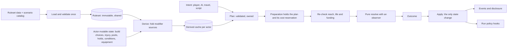

# Rules architecture refactor guide

Status: **accepted and implemented** for the current creature refactor. This
guide sets the principles and target shape for creatures, abilities, items,
conditions and their resolution. The maintainer approved the milestone and its
coordinated format changes; future milestones still require approval under
[AGENTS.md](../AGENTS.md#publishing). The [rules reference](creature-implementation.md)
describes current behavior, and the [refactor guide](creature-refactor.md) records
the implementation scope.

The goal is a foundation that stays clean, robust, fast and understandable as
features are added. Each new feature should add data, or one well-placed
mechanism. It shouldn't add another parallel path.

## Principles

Each principle comes with a test you can apply in review.

### P1. Game content is data; the engine is a small set of verbs

Abilities, talents, conditions, resource definitions, creature types, classes
and tuning constants belong in a ruleset that is loaded as data. Rust
implements general mechanisms: checks, edge, damage and protection, modifiers,
conditions, costs, timing, reach and targeting.

*Review test:* adding an ability, talent or condition built from existing
mechanisms changes no Rust. New Rust is justified only by a genuinely new
mechanism, such as forced movement, summoning or area targeting, and that
mechanism is then available to every ability.

This is also how underused attributes gain impact. Pointing an ability's check
at Cognitive defense, or creating a condition resisted by Insight, should be a
data edit.

### P2. One mechanism per concept, with no parallel or legacy paths

Each concept gets exactly one representation and one code path: damage,
protection, an attack, an effect, an event, an outcome. When a new model
replaces an old one, the old one is deleted in the same change. "Compatibility
views", shims kept so existing tests still pass, and functions called only by
tests are not allowed.

*Review test:* `grep` for the concept finds one implementation. No
`unreachable!()` branch exists to keep two models apart.

### P3. Every derived value is one fold over modifier sources

All sources of modifiers produce derived values the same way. The sources are
species, creature type, subtype, class, template, talent, equipment and active
conditions. Derivation is a pure, ordered fold. Its result is cached and
recomputed only when a source changes.

*Review test:* every number shown to a player, or used in a roll, can be
explained as a list of contributing sources. Inspection and diagnostics read
that list; they never re-derive it.

### P4. Validate once into a typed value, then carry it

Validation produces an owned value that proves what was checked: a `Plan` for
an action, a validated ruleset or build. Later stages consume that value.
Resolution re-checks only what can change in between, such as reach, life,
funding and target existence. It never recomputes timing, costs or operands it
already holds.

*Review test:* no `.expect("validated …")` depends on a check made in another
function or module. Each expensive query (sight scenes, effective stats) runs
at most once per decision.

### P5. Resolution is pure; state changes in one place

`resolve` is a pure function: given a plan, combatant snapshots, the random
state and an observer, it returns an `Outcome`. Applying that outcome is the
only place that changes injury, resources, conditions, death and the event
log. Events are produced from outcomes.

*Review test:* tests and production call the same resolver. Diagnostics are
the observer's trace plus the outcome; they need no separate capture path.

### P6. Types make invalid states unrepresentable

- Use an enum with data instead of a flag next to an `Option`.
- Use named structs instead of tuples.
- Use typed maps (`ByAttribute<T>`, `ByResource<T>`) instead of positional
  arrays and `as usize` indexing.
- Rules enums are matched exhaustively; `_ => {}` never swallows a variant.

*Review test:* there is no validity function whose job is to cross-check two
fields that could have been one type.

### P7. Errors carry meaning; reachable failures never panic

Each layer has its own error enum whose variants name the actual reason (no
such ability, ineligible, out of reach, unfunded, dead, capacity). A generic
"invalid location" error is not used for unrelated failures. Capacity limits
reachable from data or play degrade in a defined way, for example by
refreshing or evicting the oldest entry; they don't panic. `expect` is reserved
for invariants guaranteed by the surrounding code.

Timed conditions use their declared stacking and capacity policy. If expiry or
immunity removes a modifier that made the remaining combination valid, the engine
evicts the oldest remaining condition until derivation succeeds. The independently
validated build-and-equipment baseline guarantees termination within the condition
limit. Removed capacity reconciles held costs; removed health can cause death.
Actors retain a raw active-time stamp, and a deadline index settles only due actors;
reads project an individual actor without mutating unrelated actors. Saves preserve
the raw stamp and state so frozen and detached actors retain the same elapsed time.

### P8. Content identity is a stable string ID, defined once

Content (abilities, talents, conditions, species, templates) is identified by
an interned string ID from the ruleset or scenario. These IDs are readable in
saves, logs and authoring, and reordering a declaration can't change their
meaning. Closed Rust enums remain only for engine mechanisms: damage
categories, resource kinds, stat kinds and effect kinds.

Independent protocol and save types remain the policy. Those types carry IDs
and disclosed display data rather than mirroring the rules catalog one variant
at a time.

*Review test:* adding a talent touches no enum and no mapping function in
another crate.

### P9. Persist choices and mutable state, never definitions or caches

A save names the ruleset it was written with (by ID and content hash) and
contains the scenario catalog once. Each actor's record stores references
(species, templates), its owned advancement choices, and mutable state such as
injury, pools, holds, conditions and identity. Derived values and copies of
definitions are never saved. Strict decoding goes through the same validating
constructors the runtime uses. The current-version-only policy stays, which
keeps deleting old record shapes cheap.

### P10. Tests follow the current architecture

- The pure kernel (dice, checks, edge, damage, protection, derivation,
  eligibility) is tested exhaustively, with tables and properties, against a
  small fixture ruleset.
- Engine lifecycles (prepare, interrupt, resume, complete, death, restart and
  rewind equivalence) get a few integration scenarios each.
- Actual-process tests cover user-visible flows, as the
  [testing policy](testing.md) requires.
- Fixtures come from builders and ruleset data, not repeated hand-built
  literals.
- When the model changes, the tests are rewritten to the new model. No
  production function, field or format exists only to keep an old test
  compiling.

### P11. Docs describe the system, not its history

A guide states the rules and boundaries as they are. Implementation diaries,
commit hashes, CI timings and acceptance logs belong in pull request
descriptions or the history archive.

## Target architecture



### Ruleset

A `Ruleset` is loaded from data, validated once and shared (`Arc`). It
contains:

- catalogs for abilities, talents, conditions, creature types, subtypes,
  classes, resources and equipment slots;
- a typed `Constants` block with base defense, attribute caps, recovery
  periods, the duration-scaling formula, and training and attribute
  opportunity rates;
- one `limits` module for structural bounds. Today, magic numbers such as
  `1_000_000`, 32, 64, 128 and 256 are scattered across modules.

Scenario packages add species, templates, items and archetypes that refer to
ruleset IDs. The scenario's `ruleset` field names the ruleset it uses.

### Modifiers and derivation

```rust
enum Stat {
    Attribute(Attribute),
    Defense(DefenseKind),
    Health,
    ResourceMax(ResourceKind),
    Ability(AbilityId, AbilityStat), // dice, flat bonus, difficulty, duration, range
    Protection(Selector),
}

enum Op {
    Add(i32),
    Set(i32),
    Flag(FlagId),
    Immunity(Selector),
    GrantAbility(AbilityId),
}

enum Scope {
    Always,
    VersusSource, // conditions such as fear apply only against their causer
}

struct Modifier { stat: Stat, op: Op, scope: Scope }

enum SourceId {
    Species(SpeciesId), Type(TypeId), Subtype(SubtypeId), Class(ClassId),
    Template(TemplateId), Talent(TalentId),
    Equipment(ItemId), Condition(ConditionId, ActorId),
}
```

`derive(build, equipment, conditions, &Ruleset) -> Derived` is one fold:

1. template stages, grouped by priority, with conflicts rejected;
2. additive modifiers;
3. overrides;
4. clamps;
5. limit checks.

Implied rules are written as data on their flag's definition, for example
"mindless grants fear and mind-affecting immunity". They are not hidden inside
derivation code.

### Abilities, effects and checks

```rust
struct AbilityDef {
    id: AbilityId,
    cost: Option<Cost>,                 // resource, start and resolution amounts
    timing: Timing,                     // prepare, recover, scaled_by
    reach: Reach,                       // Melee | Sight { range } | Self_ | ...
    check: Option<CheckDef>,
    on_success: Vec<Effect>,
    on_failure: Vec<Effect>,
    descriptors: Vec<DescriptorId>,
    ai: AiHints,
}

struct CheckDef { roll: Skill, against: Against, edge: EdgeRule }
enum Against { Defense(DefenseKind), Difficulty(Formula), Opposed(Skill) }

enum Effect {
    Damage(DamageExpr),                 // includes "the selected weapon"
    Heal(DiceExpr),
    ApplyCondition { id: ConditionId, duration: DurationExpr },
    Restore { resource: ResourceKind, amount: DiceExpr },
}
```

The basic attack, techniques, spells, consumables, traps and hazards all use
this one vocabulary, and all damage goes through one protection kernel.

The resolver keeps the observer-generic design. One entry point takes
`&mut impl Observer`, and ordinary callers pass `&mut ()`. Runtime scripting,
if it's adopted later, extends this vocabulary; see
[scenario scripting](scripting.md).

### Conditions

```rust
struct ConditionDef {
    id: ConditionId,
    modifiers: Vec<Modifier>,
    stacking: Stacking,                 // Refresh | Longest | Stack(n)
    source_scoped: bool,
    descriptors: Vec<DescriptorId>,     // immunity checks use these
    capacity: Eviction,                 // what happens at the bound
}
```

Conditions are modifier sources, so their effects appear in derivation and
inspection like any other source.

Timers settle lazily. Each actor records the active tick it was last settled
at, and is settled when it is touched or its deadline fires. A global deadline
index supplies the next creature event. Frozen and detached actors keep the
current semantics: they receive no active time.

### Actions and plans

An intent is validated into an owned `Plan` variant: ability, equip, unequip,
or drink. Each variant contains only its applicable data. An ability carries its
ID, actor and target, cost, reach, preparation and recovery durations, check
operands, descriptors and evaluated effect operands. Item actions carry their
actor, item and preparation duration; equip also carries a socket, and drink
carries its captured effects. The action's identity is stored once, with no
separate work record or optional ability fields to cross-check.

The preparation stores the plan, and resume reuses it. Check bonuses, thresholds,
reach, costs, durations and effect values stay frozen from admission, including
dice expressions. Random rolls happen only at resolution. Completion re-checks
live reach, life, target existence and funding without rebuilding those operands.
Equipping, unequipping and consuming items use data-defined timing.

`abilities::plan` compiles and validates the owned values. `abilities::resolve`
borrows an ability plan or an unconditional effect slice, resolves through one
observer-generic kernel, and returns an outcome without changing game state.
`abilities::execution` coordinates live revalidation and resolution;
`lifecycle` owns outcome publication and state changes. Checkpoint decoding
rejects fields that do not belong to the stored action variant.

AI evaluates candidate plans against a single perception snapshot per
decision.

### Run policy

```rust
enum RunMode { Adventure(AdventureRun), Arena(ArenaRun) }
```

The kernel calls policy hooks: `on_death`, `on_action_committed` and
`deadline`. It never branches on the run mode inline. Pause and step are arena
driver policy built on those hooks. `CombatWorld` owns one tagged policy value;
only adventure state stores objectives and their outcome. Arena state is either
active (running or paused with a remaining action budget) or stopped with a reason.
Stopped arenas retain no step permission. Elimination takes precedence over action
and tick limits, including deaths discovered while settling the final timestamp;
action limits take precedence when both limits coincide. Invalid controls leave
the game unchanged. RNG and resolution events belong to the game, not either policy.

### Protocol and clients

Clients receive a personal list of available abilities:
`{ id, name, cost, reach, target_kind }`. Requests carry
`UseAbility { id, target }`. The text client resolves verbs from the disclosed
names, and the ASCII client builds its menu from the same list. Adding content
then changes no wire type and no client lexicon. Inspection and diagnostics
disclose sources and steps by ID with display names.

## Checklist for new features

Before merging a feature, confirm:

- [ ] Content is data; any new Rust is a reusable mechanism (P1).
- [ ] No second path exists for a concept that already had one; anything it
      replaced is deleted (P2).
- [ ] New numbers flow through modifiers and derivation (P3).
- [ ] Validation produces a value that later stages consume (P4).
- [ ] State changes only through outcome application (P5).
- [ ] No tuples, positional arrays, wildcard rule matches or cross-checked
      flag pairs (P6).
- [ ] Specific errors; no reachable panics (P7).
- [ ] Content IDs, not new enums mirrored across crates (P8).
- [ ] Saves hold references and mutable state only (P9).
- [ ] Tests target the current model, at every layer the change touches (P10).
- [ ] Guides describe the result, not the process (P11).
